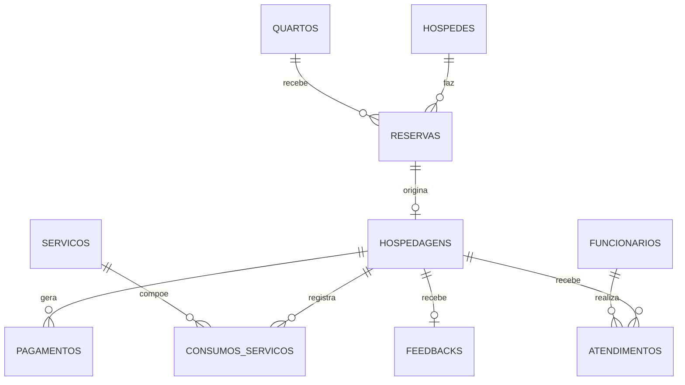

# Origem do sistema

O Hotel Nebula precisa reunir reservas, estadias, serviços e recebimentos hoje registrados em fontes diferentes. O modelo abaixo considera uma unidade do hotel. Os números de quarto são únicos dentro dessa unidade.

## Modelo

isso aqui eu fiquei imprecionado tá, não sabia que dava, bom saber.
## Modelo lógico

| Tabela | Chave primária | Chaves estrangeiras | Demais atributos |
|---|---|---|---|
| hospedes | id_hospede | — | nome, email, cpf, telefone, data_nascimento, criado_em |
| quartos | id_quarto | — | numero, tipo, capacidade, preco_diaria, status, andar |
| reservas | id_reserva | id_hospede → hospedes, id_quarto → quartos | data_checkin, data_checkout, status, quantidade_hospedes, diaria_contratada, criada_em, cancelada_em |
| hospedagens | id_hospedagem | id_reserva → reservas, única | checkin_real, checkout_real, observacoes |
| pagamentos | id_pagamento | id_hospedagem → hospedagens | valor, metodo, status, pago_em |
| funcionarios | id_funcionario | — | nome, cargo, email, data_admissao, ativo |
| servicos | id_servico | — | nome, descricao, preco_atual, ativo |
| consumos_servicos | id_consumo | id_hospedagem → hospedagens, id_servico → servicos | quantidade, preco_unitario, consumido_em |
| atendimentos | id_hospedagem + id_funcionario | id_hospedagem → hospedagens, id_funcionario → funcionarios | atendido_em |
| feedbacks | id_feedback | id_hospedagem → hospedagens, única | nota, comentario, avaliado_em |

## Relacionamentos e regras de negócio

- Um hóspede pode ser titular de várias reservas. Cada reserva pertence a um hóspede e a um quarto.
- Uma reserva gera no máximo uma hospedagem. Reservas futuras ou canceladas podem não ter hospedagem. O horário real de saída fica vazio enquanto o hóspede permanecer no hotel.
- A data de saída é posterior à entrada. A disponibilidade considera entrada inclusiva e saída exclusiva, permitindo nova reserva para o mesmo quarto no dia da saída. Quartos em manutenção ou inativos ficam fora do resultado. Reservas canceladas não ocupam vagas.
- Uma hospedagem pode ter vários pagamentos. Só pagamentos confirmados entram no faturamento, agrupados pelo mês em que foram recebidos.
- Hospedagens e serviços têm relação muitos-para-muitos. Cada consumo registra quantidade, data e preço unitário praticado. A reserva também guarda a diária contratada para preservar o histórico de preços.
- Hospedagens e funcionários têm relação muitos-para-muitos. A chave composta de atendimentos garante uma contagem por profissional e hospedagem.
- Uma hospedagem pode ter uma avaliação de 1 a 5, feita pelo titular. O hóspede e o quarto são recuperados pela reserva, evitando duplicar as referências em feedbacks.

### Regras para a futura API

Ao criar ou alterar uma reserva, a API deverá verificar disponibilidade e capacidade dentro da mesma transação, bloqueando o registro do quarto antes da consulta para serializar solicitações concorrentes. O script inicial aplica as restrições declarativas de cada linha e as chaves relacionais. Cancelamento de reserva com estadia iniciada, consumo dentro da estadia e feedback após o checkout precisarão ser validados nos fluxos da API.
